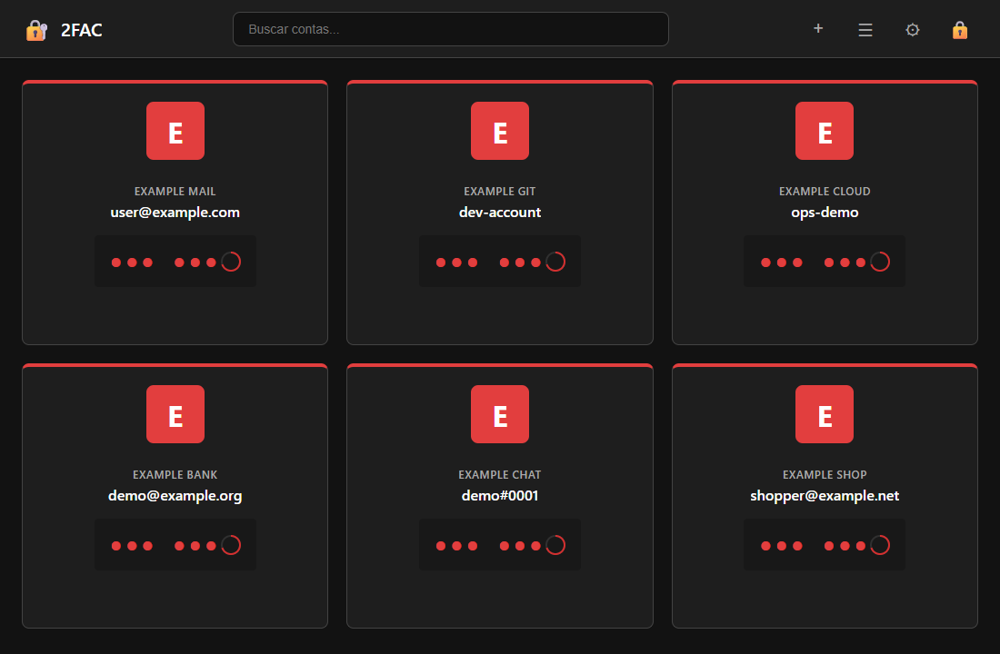
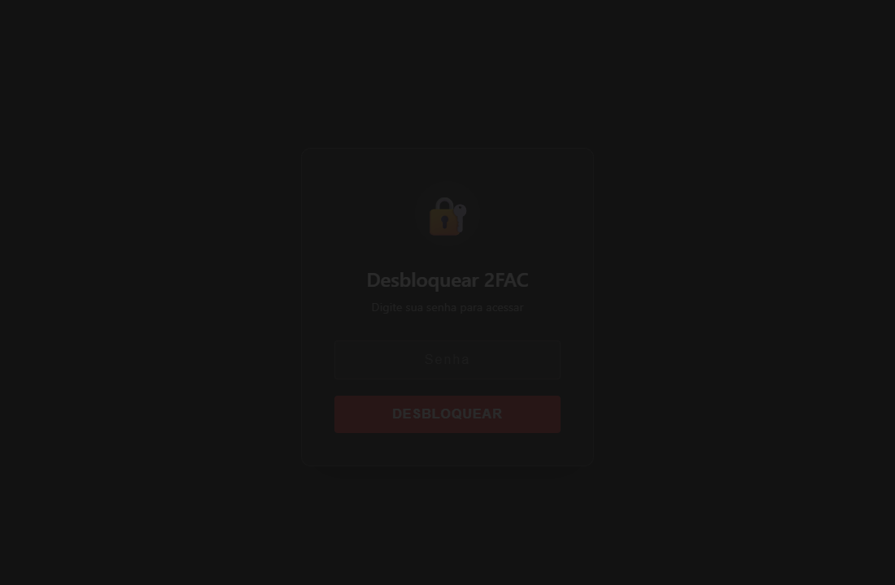
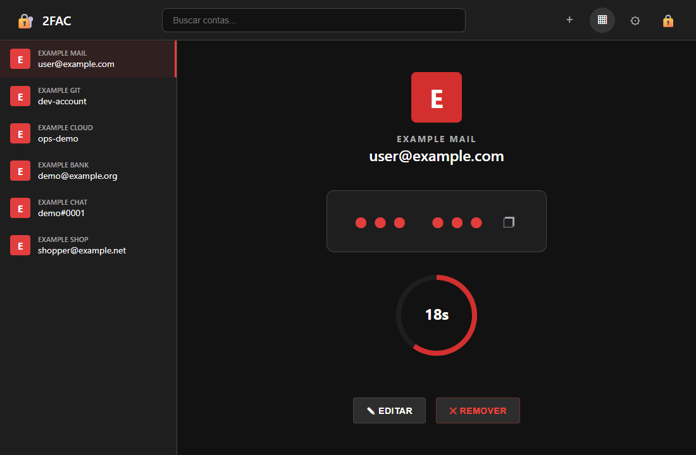
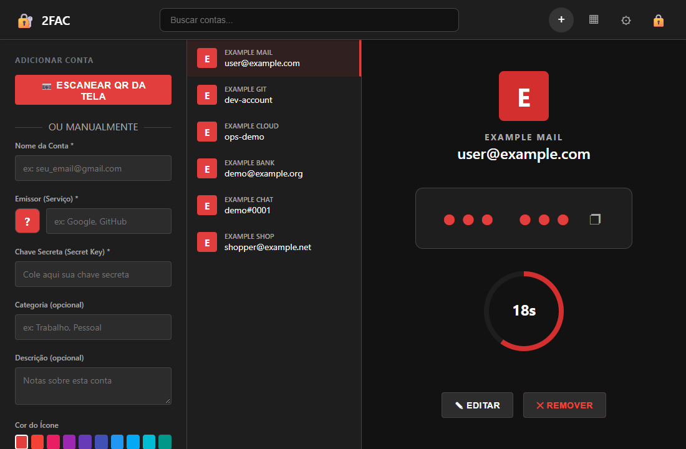
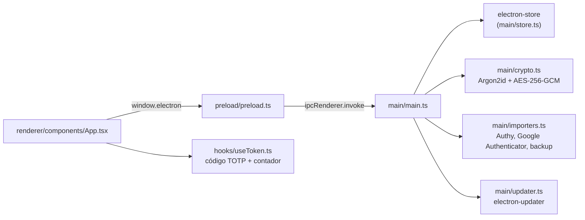

<div align="center">


# 🔐 2FAC - Gerenciador Universal de Autenticação 2FA

**Gerenciador desktop de códigos 2FA (TOTP), local e sem nuvem, para quem quer os segredos só na própria máquina.**<br/>
Códigos RFC 6238 gerados offline, backup em JSON e importação direta do Authy.


[](https://github.com/juninmd/2fac/actions/workflows/ci.yml)

<br/>



</div>

O **2FAC** é um gerenciador de autenticação de dois fatores (2FA) desktop de alto desempenho, focado em privacidade e facilidade de uso. Desenvolvido com **Electron** e **React**, ele oferece uma alternativa robusta e local para gerenciar seus segredos TOTP com segurança total.

---

## ✨ Recursos de Elite

*   📱 **Gestão Unificada:** Gerencie múltiplas contas de serviços diversos em uma única interface elegante.
*   🔐 **TOTP Nativo:** Geração instantânea de códigos (Time-based One-Time Password) conforme RFC 6238.
*   📤 **Portabilidade Total:** Exportação e importação via JSON para backups fáceis e seguros.
*   🔑 **Migração do Authy:** Importe facilmente suas contas existentes do Authy.
*   🎯 **Experiência Fluida:** Interface responsiva com suporte a Drag-and-Drop para reordenação personalizada.
*   ⚡ **Leve & Rápido:** Construído para ser eficiente em recursos do sistema.

---

## 🖼️ Tour

Capturas feitas com contas fictícias (`example.com`).

| | |
| :---: | :---: |
| <br/>**Bloqueio**<br/><kbd>Ctrl</kbd>+<kbd>L</kbd><br/>Senha mestra antes de qualquer código. | <br/>**Grade**<br/><kbd>Ctrl</kbd>+<kbd>F</kbd><br/>Todas as contas de uma vez, com busca. |
| <br/>**Lista e detalhe**<br/>Alterna pelo botão da barra.<br/>Detalhe, edição e remoção da conta. | <br/>**Adicionar conta**<br/><kbd>Ctrl</kbd>+<kbd>N</kbd><br/>Escaneie o QR da tela ou digite a chave. |

Atalhos globais do app: <kbd>Ctrl</kbd>+<kbd>F</kbd> busca, <kbd>Ctrl</kbd>+<kbd>L</kbd> bloqueia, <kbd>Ctrl</kbd>+<kbd>N</kbd> adiciona, <kbd>Ctrl</kbd>+<kbd>,</kbd> abre Configurações, <kbd>Esc</kbd> fecha painéis (<kbd>Cmd</kbd> no macOS).

---

## 🧭 Como Funciona



O renderer nunca importa módulos Node: tudo que toca disco, senha ou importação passa pelo preload e pelos handlers `ipcMain` do processo principal.

---

## 🛠️ Tecnologias Utilizadas

| Camada | Tecnologia |
| :--- | :--- |
| **Engine** | [Electron](https://www.electronjs.org/) |
| **Interface** | [React](https://reactjs.org/) + [TypeScript](https://www.typescriptlang.org/) |
| **Core 2FA** | [OTPAuth](https://github.com/hectorm/otpauth) / [Speakeasy](https://github.com/speakeasyjs/speakeasy) |
| **Storage** | [Electron Store](https://github.com/sindresorhus/electron-store) |
| **Bundler** | [Webpack](https://webpack.js.org/) |

---

## 🚀 Como Iniciar

### Pré-requisitos

*   Node.js (v22+)
*   pnpm (recomendado) ou npm

### Instalação & Desenvolvimento

```bash
# Clone o repositório
git clone https://github.com/juninmd/2fac.git

# Instale as dependências
pnpm install

# Inicie o modo de desenvolvimento
pnpm run electron:dev
```

### Build para Produção

```bash
# Gere o instalador para sua plataforma
pnpm run electron:build
```

### Develop

```bash
pnpm install --frozen-lockfile   # instala as dependências conforme o lockfile
pnpm run electron:dev            # compila o main, sobe o webpack-dev-server (porta 3000) e abre o Electron
pnpm exec jest --ci              # testes unitários
pnpm run test:scripts            # testes do cálculo de versão do release (node --test)
pnpm run lint                    # ESLint
pnpm run build:main              # tsc --noEmit + bundle do processo principal em dist/main
pnpm run build:renderer          # bundle de produção da interface em dist/renderer
```

### Releases e atualização automática

Cada commit no `main` gera tag, build dos instaladores e GitHub Release automaticamente (versão por Conventional Commits); o app se atualiza sozinho. Detalhes em [`docs/RELEASE.md`](docs/RELEASE.md).

---

## ⚙️ Configurações do App

Ficam em Configurações (<kbd>Ctrl</kbd>+<kbd>,</kbd>) e são salvas localmente. Chaves do objeto `AppSettings` em `src/main/types.ts`:

| Chave | Propósito |
| :--- | :--- |
| `autoLock` / `autoLockTimeout` | Bloqueia o app após o tempo de inatividade configurado. |
| `blurOnInactive` | Desfoca a interface quando a janela perde o foco. |
| `maskSecrets` | Mantém os códigos mascarados até clicar para revelar. |
| `minimizeToTray` | Minimiza para a bandeja do sistema. |
| `runOnStartup` | Inicia junto com o sistema. |

---

## 🔒 Segurança em Primeiro Lugar

O **2FAC** adota uma política de **Zero Trust** e **Privacidade Local**:
*   **Isolamento Total:** Context Isolation e Sandbox habilitados por padrão.
*   **Dados Locais:** Nenhuma informação sai do seu computador. Não há sincronização com nuvens proprietárias sem seu consentimento explícito (em planos futuros).
*   **Sem Telemetria:** O app não rastreia seu uso nem coleta métricas.

---

## 📂 Estrutura do Projeto

```text
src/
├── main/              # Processo principal (Lógica de Sistema/OS)
├── preload/          # Ponte segura entre Main e Renderer
└── renderer/         # Interface do Usuário (React)
    ├── components/   # Blocos de construção da UI (App.css e telas)
    ├── hooks/        # Lógica de estado e efeitos
    └── utils/        # Utilitários (ícones de marca, reordenação)
public/               # Ícone e HTML base
```

---

## 📚 Documentação

| Arquivo | Conteúdo |
| :--- | :--- |
| [`QUICKSTART.md`](QUICKSTART.md) | Guia de início rápido do desenvolvimento. |
| [`docs/RELEASE.md`](docs/RELEASE.md) | Release automático, auto-update, assinatura e limites por plataforma. |
| [`docs/COMPARACAO_UI.md`](docs/COMPARACAO_UI.md) | Protótipo de UI × UI atual e paridade com o Authy. |
| [`ROADMAP.md`](ROADMAP.md) | Fases planejadas de evolução. |
| [`CAPABILITIES.md`](CAPABILITIES.md) | Funcionalidades e estrutura para desenvolvedores e agentes. |
| [`SECURITY.md`](SECURITY.md) | Política de segurança. |

---

## ⚠️ Limitações Conhecidas

*   **Sem sincronização multi-dispositivo** e sem app mobile (veja [`docs/COMPARACAO_UI.md`](docs/COMPARACAO_UI.md)).
*   O auto-update consulta o GitHub Releases; no macOS exige app assinado e notarizado, no Linux só o AppImage se atualiza e no Windows só o instalador NSIS (detalhes em [`docs/RELEASE.md`](docs/RELEASE.md)).

> [!WARNING]
> Sem assinatura de código (Windows/macOS), a integridade do instalador depende do TLS do GitHub e do `sha512` publicado no mesmo release.

---

## 🤝 Contribuição

Contribuições são o que tornam a comunidade open source um lugar incrível para aprender, inspirar e criar.

1. Faça um **Fork** do projeto
2. Crie sua **Feature Branch** (`git checkout -b feature/AmazingFeature`)
3. Faça **Commit** de suas mudanças (`git commit -m 'Add some AmazingFeature'`)
4. Faça **Push** para a branch (`git push origin feature/AmazingFeature`)
5. Abra um **Pull Request**

---

## 📄 Licença

Distribuído sob a licença **MIT** (declarada em `package.json`; o repositório ainda não tem um arquivo `LICENSE`).

---

*"Proteja seu acesso digital com simplicidade e soberania de dados."*
